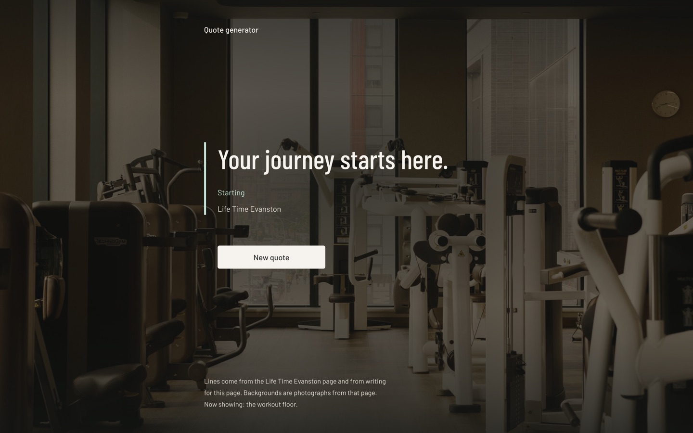
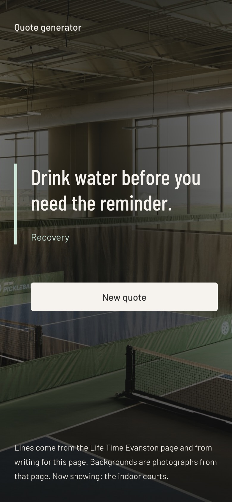

# Quote generator

A single-screen training-quote generator built with Next.js. One quote, one button, and a full-bleed photo behind the text that cross-fades each time you ask for a new line.

It started as a small build exercise. I then used it to practise careful layout work, and to check the result by measuring the rendered page instead of eyeballing it.

| Desktop (1440px) | Phone (390px) |
|---|---|
|  |  |

## What it does

- Shows a random quote with its theme (Starting, Recovery, Strength and so on).
- **New quote** fetches another one, never repeating the current quote, and swaps the background photo at the same time.
- The next photo is preloaded in parallel with the quote request, so the text never changes before the image is ready and the screen never flashes black.
- If the request fails, an inline message appears and the button works again.

## Design decisions

Every layout choice is deliberate, and I checked each one against the rendered page:

- **8px spacing base.** Page margins and gaps are multiples of 8. The one exception is the button's 28px left padding, which is the quote's 24px padding plus its 4px border so the button lines up with the quote text. It is commented in the code.
- **Grouping by distance.** The quote, its theme and its source sit 8 to 24px apart. The button is 64px away, so it reads as a separate action.
- **One focal point, one action.** The quote leads, and there is a single light button on the dark photo.
- **Golden-ratio line height.** 1.618 times the font size, rounded to a whole number matching the size's parity: 16px text uses 26px, 14px text uses 24px.
- **Readable text over photos.** A dark gradient veil sits over every photo, heavier at the top, bottom and centre where text lives.
- **Comfortable line length.** The footer is capped so lines run about 8 words, down from about 13 before I measured it.
- **Touch and accessibility basics.** A 48px-tall button, a real `<h1>`, `aria-live` on the quote, `role="alert"` on errors, `aria-busy` while loading, visible focus rings, and animations switched off under `prefers-reduced-motion`.

## How I checked it

- Measured the rendered page in the browser at 1920px and 390px: spacing, font sizes, line heights, words per line, tap-target size, and that nothing scrolls sideways.
- `npm run build`, `tsc --noEmit` and ESLint all pass.
- There are no automated tests yet.

## How it's built

- **Next.js 16** (App Router), **React 19**, **TypeScript**, **Tailwind CSS v4**, `next/font` (Barlow and Barlow Condensed).
- The server picks the first quote and photo on each request. A client component, `QuoteBoard`, owns the interaction.
- `GET /api/quote?avoid=<id>` returns a random quote that differs from the current one, with `Cache-Control: no-store`.
- Cache Components and Partial Prefetching are on. The page is a static shell with the quote streamed in per request, using `connection()` inside a `<Suspense>` boundary. The production build lists `/` as a partial prerender.

```
src/
  app/
    layout.tsx        fonts, metadata, default backdrop
    page.tsx          server component: picks quote and photo, Suspense fallback
    api/quote/        route handler for the next quote
    globals.css       design tokens, photo veil, animations
  components/
    quote-board.tsx   client component: state, fetch, photo cross-fade
  lib/
    quotes.ts         quote data and pickQuote()
    scenery.ts        background photos and pickScene()
```

## Run it locally

```bash
npm install
npm run dev
```

Open [http://localhost:3000](http://localhost:3000). For a production build, run `npm run build` and then `npm start`.

## Ideas for next

- A copy-to-clipboard button.
- Filtering quotes by theme.
- Automated tests for `pickQuote` and the API route.

## Attribution and takedown

The background photographs and the quote lines tagged "Life Time Evanston" come from the Life Time Evanston club page (https://www.lifetime.life/locations/il/evanston.html). They are used here only as demo content in a personal portfolio project. I am not affiliated with Life Time, and I do not claim any rights to that material. If you represent Life Time and want it removed, open an issue on this repository and I will take it down promptly. The remaining quotes were written for this project.
